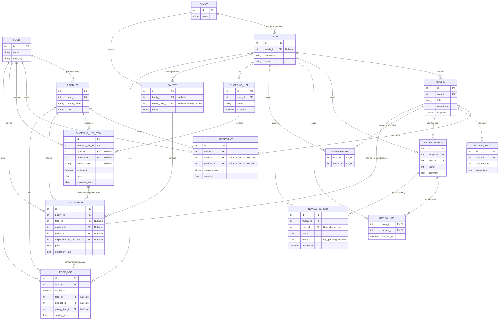

# Database ERD

An entity relationship diagram of the EatForkful database: entity names, keys and relationships, not every column. The source of truth for the actual tables is `src/db/schema.ts`.

The diagram is Steve's (2026-11-17) and may describe the **intended** model, not only today's tables. It currently differs from the schema in several places; those differences are listed in the pull request that added this file (#279) and are waiting on Steve's decision, so the diagram has not been changed to match the schema.

A PR that changes `src/db/schema.ts` must update this file or say why not.

Last verified: 2026-11-16, against migration `0035_goofy_forgotten_one.sql` (main at `6e50725`). Verified means the differences were listed, not that the diagram matches the schema.

