# Database ERD

An entity relationship diagram of the EatForkful database. Entity names are the table names in `src/db/schema.ts` in upper case, and every column is listed with its type, key, nullability and default. The source of truth is `src/db/schema.ts`.

Two entities are **planned features** (Steve, 2026-11-25), not drift: `FAMILY` and `PANTRY`. They have no table yet. Their relationships are labelled `PLANNED` and imply columns that do not exist yet (`users.family_id`, `pantry_items.pantry_id`); those columns are not drawn on `USERS` and `PANTRY_ITEMS` so the existing tables stay true to the schema. Everything else matches the schema.

Reading the diagram: types are the Postgres type; lengths and precision are in the comment as `(255)` or `(10,2)`. A column is nullable only when its comment says "Nullable". `serial` is an auto-increment integer. Soft-deleted tables carry a nullable `date_deleted` (see CLAUDE.md). `ON DELETE` behaviour is in each relationship label (`CASCADE` or `SET NULL`).

A PR that changes `src/db/schema.ts` must update this file or say why not.

Last verified: 2026-11-25, against main at `524861d`. All 21 tables in `src/db/schema.ts` were verified at column level (names, types, nullability, defaults, primary keys, foreign keys with ON DELETE, unique constraints). The delivery flow for `EVENTS` is in `docs/flows/admin-signals.md`. Other flows: `INVITES`, `WAITLIST_ENTRIES`, `OAUTH_ACCOUNTS` and `LOGIN_ATTEMPTS` in `docs/flows/invite-waitlist-signup.md`; `PASSWORD_RESET_TOKENS` in `docs/flows/password-reset.md`; `ACCOUNT_FEEDBACK` in `docs/flows/account-closure.md`; `REVIEWS`, `REVIEW_LIKES` and `REVIEW_REPORTS` in `docs/flows/review-moderation.md`; `FOOD_LOG_ENTRIES` in `docs/flows/food-log.md`.

```mermaid
erDiagram
    %% Foods and products
    FOODS {
        serial id PK
        varchar name "(255)"
        varchar slug UK "(255), Nullable"
        int calories
        numeric protein "(10,2), default 0"
        numeric carbs "(10,2), default 0"
        numeric fat "(10,2), default 0"
        numeric fiber "(10,2), default 0"
        numeric serving_size "(10,2), default 1"
        varchar serving_unit "(50), Nullable"
        jsonb measurements "Measurement[], Nullable, default []"
        numeric density "(10,4), Nullable"
        numeric saturated_fat "(10,2), Nullable"
        numeric sugar "(10,2), Nullable"
        numeric sodium "(10,1), Nullable"
        varchar external_id "(100), Nullable"
        enum source "food_source: manual, open_food_facts, usda. Default manual"
        timestamp date_added "Nullable, default now"
        timestamp date_updated "Nullable"
        timestamp date_deleted "Nullable, soft delete"
    }

    PRODUCTS {
        serial id PK
        varchar name "(255)"
        varchar slug UK "(255), Nullable"
        varchar barcode "(50), Nullable"
        varchar external_id "(100), Nullable"
        int parent_food_id FK "Nullable, ON DELETE SET NULL"
        int calories
        numeric protein "(10,2), default 0"
        numeric carbs "(10,2), default 0"
        numeric fat "(10,2), default 0"
        numeric fiber "(10,2), default 0"
        numeric serving_size "(10,2), default 1"
        varchar serving_unit "(50), Nullable"
        jsonb measurements "Measurement[], Nullable, default []"
        numeric density "(10,4), Nullable"
        numeric saturated_fat "(10,2), Nullable"
        numeric sugar "(10,2), Nullable"
        numeric sodium "(10,1), Nullable"
        enum source "product_source: manual, open_food_facts, usda_branded. Default manual"
        timestamp date_added "Nullable, default now"
        timestamp date_updated "Nullable"
        timestamp date_deleted "Nullable, soft delete"
    }

    %% Users and account tables
    USERS {
        serial id PK
        varchar username UK "(255)"
        varchar password "(255), Nullable (OAuth-only users)"
        varchar email UK "(255)"
        jsonb cuisine_preferences "string[], Nullable, default []"
        jsonb dietary_restrictions "string[], Nullable, default []"
        jsonb meal_slots "string[], Nullable, default Breakfast/Lunch/Dinner/Snack"
        varchar avatar_url "(500), Nullable"
        timestamp onboarding_completed_at "Nullable"
        timestamp password_changed_at "Nullable"
        boolean marketing_email_opt_in "default false"
        enum recipe_suggestion_frequency "never, weekly, monthly. Default weekly"
        enum pantry_expiration_frequency "never, daily, weekly. Default weekly"
        boolean enable_shopping_list_pricing_collection "default true"
        int calorie_goal "Nullable, Nutrition Goal"
        numeric protein_goal "(10,2), Nullable"
        numeric carbs_goal "(10,2), Nullable"
        numeric fat_goal "(10,2), Nullable"
        numeric fiber_goal "(10,2), Nullable"
        timestamp date_added "Nullable, default now"
        timestamp date_deleted "Nullable, soft delete"
        timestamp deactivation_warning_email_sent_at "Nullable"
        timestamp waitlist_notice_sent_at "Nullable, null = not yet sent"
    }

    OAUTH_ACCOUNTS {
        serial id PK
        int user_id FK "ON DELETE CASCADE"
        varchar provider "(50), unique with provider_account_id"
        varchar provider_account_id "(255)"
        timestamp date_added "default now"
    }

    PASSWORD_RESET_TOKENS {
        serial id PK
        int user_id FK "ON DELETE CASCADE"
        varchar token_hash UK "(64), SHA-256, never the raw token"
        timestamp expires_at
        timestamp used_at "Nullable"
        timestamp date_added "default now"
    }

    LOGIN_ATTEMPTS {
        serial id PK
        int user_id FK "Nullable, ON DELETE CASCADE"
        varchar ip_address "(45)"
        int successful "0 = false, 1 = true. Default 0"
        timestamp date_added "default now"
    }

    ACCOUNT_FEEDBACK {
        serial id PK
        int user_id "NOT a foreign key, so it survives account deletion"
        enum action "account_closure_action: deactivated, deleted"
        jsonb reasons "string[], default []"
        text comment "Nullable"
        timestamp created_at "default now"
    }

    WAITLIST_ENTRIES {
        serial id PK
        varchar email "(254), unique on lower(email), no FK to USERS"
        varchar name "(100), Nullable"
        boolean marketing_email_opt_in "default false"
        timestamp date_added "default now"
    }

    INVITES {
        serial id PK
        varchar email "(254), unique on lower(email), no FK to USERS"
        varchar code_hash UK "(64), SHA-256, never the raw code"
        timestamp code_used_at "Nullable"
        timestamp date_added "default now"
    }

    EVENTS {
        serial id PK
        varchar type "(40), Admin kind, e.g. review-report"
        int user_id FK "Nullable, ON DELETE SET NULL"
        jsonb payload "Nullable"
        timestamp created_at "default now"
        varchar status "(10): pending, sent or failed. Default pending"
        int attempts "Failed sends so far. Default 0"
        text last_error "Nullable"
        timestamp next_attempt_at "Nullable, retry backoff"
        timestamp sent_at "Nullable, when the email went out"
    }

    %% Recipes
    RECIPES {
        serial id PK
        varchar name "(255)"
        varchar short_id UK "(8)"
        varchar slug "(255), Nullable, not unique"
        varchar meal "(50), Nullable"
        text description "Nullable"
        int prep_time "Nullable"
        int cook_time "Nullable"
        int total_time "Nullable"
        varchar cuisine_type "(100), Nullable"
        jsonb dietary_tags "string[], Nullable, default []"
        int is_public "0 or 1, an integer not a boolean. Default 0"
        int serves "Nullable"
        text source_url "Nullable"
        varchar source_name "(255), Nullable"
        boolean nutrition_complete "default true"
        int view_count "default 0"
        int user_id FK "Nullable, ON DELETE SET NULL"
        timestamp date_added "Nullable, default now"
        timestamp date_published "Nullable"
        timestamp date_deleted "Nullable, soft delete"
    }

    INGREDIENTS {
        serial id PK
        int recipe_id FK "ON DELETE CASCADE"
        int food_id FK "ON DELETE CASCADE. Food only, no product link"
        numeric quantity "(10,2)"
        varchar serving_unit "(50), Nullable"
        timestamp date_added "Nullable, default now"
        timestamp date_updated "Nullable"
        timestamp date_deleted "Nullable, soft delete"
    }

    RECIPE_STEPS {
        serial id PK
        int recipe_id FK "ON DELETE CASCADE"
        int position
        varchar title "(255), Nullable"
        text content "default empty string"
        timestamp date_added "Nullable, default now"
        timestamp date_deleted "Nullable, soft delete"
    }

    SAVED_RECIPES {
        serial id PK
        int user_id FK "ON DELETE CASCADE, unique with recipe_id"
        int recipe_id FK "ON DELETE CASCADE"
        timestamp date_saved "default now"
        timestamp date_deleted "Nullable, soft delete"
    }

    %% Reviews
    REVIEWS {
        serial id PK
        int user_id FK "Nullable, ON DELETE SET NULL, unique with recipe_id"
        int recipe_id FK "ON DELETE CASCADE, indexed"
        int rating
        text body "Nullable"
        timestamp date_added "default now"
        timestamp date_updated "Nullable"
    }

    REVIEW_LIKES {
        serial id PK
        int user_id FK "Nullable, ON DELETE SET NULL, unique with review_id"
        int review_id FK "ON DELETE CASCADE, indexed"
        timestamp date_added "default now"
    }

    REVIEW_REPORTS {
        serial id PK
        int user_id FK "Nullable, ON DELETE SET NULL, unique with review_id"
        int review_id FK "ON DELETE CASCADE, indexed"
        enum reason "review_report_reason: spam, offensive_language, harassment, off_topic"
        text comment "Nullable"
        timestamp date_added "default now, indexed"
    }

    %% Shopping
    SHOPPING_LISTS {
        serial id PK
        int user_id FK "ON DELETE CASCADE, one active list per user"
        enum status "shopping_list_status: active, archived. Default active"
        timestamp date_added "default now"
    }

    SHOPPING_LIST_ITEMS {
        serial id PK
        int shopping_list_id FK "ON DELETE CASCADE, indexed"
        enum source_type "food, product, freeform. Default food"
        int food_id FK "Nullable, ON DELETE CASCADE"
        int product_id FK "Nullable, ON DELETE CASCADE"
        varchar name "(255), Nullable, used by freeform lines"
        numeric amount "(10,2)"
        varchar unit "(50), Nullable"
        enum status "to_buy, bought, unavailable. Default to_buy"
        numeric line_price "(10,2), Nullable, total for the line"
        timestamp expiration_date "Nullable"
        timestamp date_added "default now"
    }

    %% Pantry and food log
    PANTRY_ITEMS {
        serial id PK
        int user_id FK "ON DELETE CASCADE"
        varchar source_type "(20), default food"
        int food_id FK "Nullable, ON DELETE CASCADE"
        int product_id FK "Nullable, ON DELETE CASCADE"
        int recipe_id FK "Nullable, ON DELETE SET NULL, prepared meal"
        varchar recipe_name_snapshot "(255), Nullable"
        int shopping_list_item_id FK "Nullable, ON DELETE SET NULL"
        timestamp expiration_date "Nullable"
        numeric original_size_amount "(10,2)"
        varchar original_size_unit "(50), Nullable"
        numeric current_size_amount "(10,2)"
        varchar current_size_unit "(50), Nullable"
        timestamp added_date "default now"
        timestamp frozen_date "Nullable"
        timestamp date_deleted "Nullable, soft delete"
    }

    FOOD_LOG_ENTRIES {
        serial id PK
        int user_id FK "ON DELETE CASCADE"
        enum source_type "food_log_source_type: food, product, prepared_meal. Default food"
        int food_id FK "Nullable, ON DELETE SET NULL"
        numeric amount "(10,2)"
        varchar unit "(50), Nullable"
        numeric calories "(10,2), frozen snapshot, default 0"
        numeric protein "(10,2), frozen snapshot, default 0"
        numeric carbs "(10,2), frozen snapshot, default 0"
        numeric fat "(10,2), frozen snapshot, default 0"
        numeric fiber "(10,2), frozen snapshot, default 0"
        date log_date "user-local calendar day"
        varchar meal_slot "(50), Nullable, label snapshot not a FK"
        timestamp date_added "default now"
        timestamp date_deleted "Nullable, soft delete"
    }

    %% PLANNED entities: no table in src/db/schema.ts yet (Steve, 2026-11-25)
    FAMILY {
        int id PK "PLANNED, no table yet"
        string name "PLANNED"
    }

    PANTRY {
        int id PK "PLANNED, no table yet"
        int family_id FK "PLANNED, Nullable"
        int owner_user_id FK "PLANNED, Nullable if family owned"
        string name "PLANNED"
    }

    %% Relationships (label: what it is, ON DELETE behaviour)
    FOODS |o--o{ PRODUCTS : "parent food, SET NULL"
    USERS |o--o{ RECIPES : "creates, SET NULL"
    RECIPES ||--o{ INGREDIENTS : "has many, CASCADE"
    FOODS ||--o{ INGREDIENTS : "types, CASCADE"
    RECIPES ||--o{ RECIPE_STEPS : "has many, CASCADE"

    USERS ||--o{ OAUTH_ACCOUNTS : "links, CASCADE"
    USERS ||--o{ PASSWORD_RESET_TOKENS : "requests, CASCADE"
    USERS |o--o{ LOGIN_ATTEMPTS : "attempts, CASCADE"
    USERS |o--o{ EVENTS : "optionally the subject of, SET NULL"

    USERS ||--o{ SAVED_RECIPES : "saves, CASCADE"
    RECIPES ||--o{ SAVED_RECIPES : "saved by, CASCADE"

    RECIPES ||--o{ REVIEWS : "has 0 or many, CASCADE"
    USERS |o--o{ REVIEWS : "writes, SET NULL"
    REVIEWS ||--o{ REVIEW_LIKES : "has 0 or many, CASCADE"
    USERS |o--o{ REVIEW_LIKES : "gives, SET NULL"
    REVIEWS ||--o{ REVIEW_REPORTS : "has 0 or many, CASCADE"
    USERS |o--o{ REVIEW_REPORTS : "submits, SET NULL"

    USERS ||--o{ SHOPPING_LISTS : "has, CASCADE"
    SHOPPING_LISTS ||--o{ SHOPPING_LIST_ITEMS : "contains, CASCADE"
    FOODS |o--o{ SHOPPING_LIST_ITEMS : "references, CASCADE"
    PRODUCTS |o--o{ SHOPPING_LIST_ITEMS : "references, CASCADE"

    USERS ||--o{ PANTRY_ITEMS : "owns, CASCADE"
    FOODS |o--o{ PANTRY_ITEMS : "can be, CASCADE"
    PRODUCTS |o--o{ PANTRY_ITEMS : "can be, CASCADE"
    RECIPES |o--o{ PANTRY_ITEMS : "prepared meal, SET NULL"
    SHOPPING_LIST_ITEMS |o--o{ PANTRY_ITEMS : "originates from, SET NULL"

    USERS ||--o{ FOOD_LOG_ENTRIES : "logs, CASCADE"
    FOODS |o--o{ FOOD_LOG_ENTRIES : "eats, SET NULL"

    %% PLANNED relationships (need users.family_id and pantry_items.pantry_id, not in schema yet)
    FAMILY ||--o{ USERS : "PLANNED: has many members"
    FAMILY |o--o{ PANTRY : "PLANNED: shares"
    USERS |o--o{ PANTRY : "PLANNED: owns personal"
    PANTRY ||--o{ PANTRY_ITEMS : "PLANNED: contains"
```

