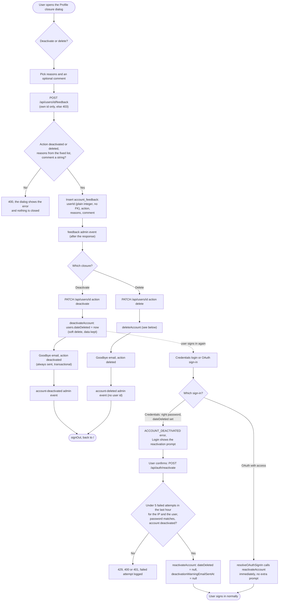
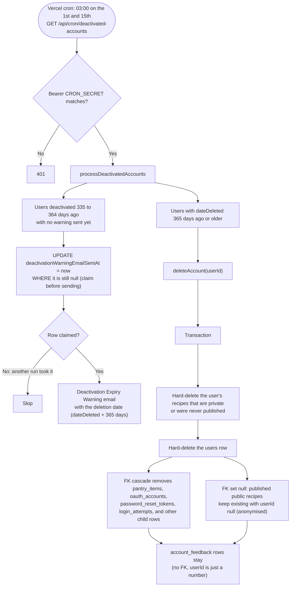

# Account closure flow

How a User closes their account: reversible Account Deactivation, permanent Account Deletion, reactivation, and the 12-month automatic deletion of deactivated accounts. Covers `account_feedback` (and the `users.dateDeleted` and `deactivation_warning_email_sent_at` columns it relates to). Decision record: ADR-0007.

Last verified: 2026-11-25, against 524861d

Key code: `src/views/Profile/Profile.tsx` (`confirmClosure`), `app/api/users/[id]/feedback/route.ts`, `app/api/users/[id]/route.ts` (actions `deactivate`, `delete`), `app/api/auth/reactivate/route.ts`, `app/api/cron/deactivated-accounts/route.ts`, `src/lib/users.ts` (`createAccountFeedback`, `deactivateAccount`, `reactivateAccount`, `deleteAccount`, `processDeactivatedAccounts`), `src/lib/waitlist.ts` (`leaveWaitlist`), `src/auth.ts`, `vercel.json` (cron).

## Closing, reactivating and deleting

## Account deletion and the 12-month cleanup

## Notes

- The Profile dialog saves feedback first, then closes the account; if feedback validation fails the account is not closed. The feedback route is authenticated, so the order matters: after deletion the session is gone.
- `deactivateAccount` is also called by the waitlist "leave" flow (`leaveWaitlist`) and `deleteAccount` by the cron; only the Profile PATCH route records the `account-deactivated` and `account-deleted` admin events.
- Goodbye emails are sent whatever the Marketing Email Opt-in is; failures are swallowed so they never fail the closure.
- A deactivated User's recipes, pantry and log stay in the database but the account cannot sign in until reactivated. The access check (`hasAccess`) is separate and described in `invite-waitlist-signup.md`.
