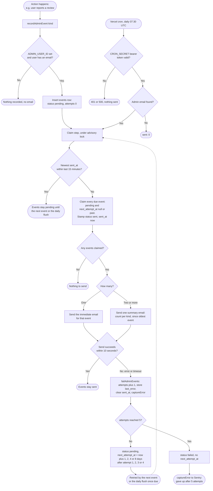

# Admin signals flow

How something that needs the admin's attention (a reported review, feedback, a deactivated or deleted account, an accepted invite) becomes an `events` row and then an email, and what happens when a send fails. Added in #416, documented in #424.

Last verified: 2026-11-25, against b4d5539

Key code: `src/lib/adminSignals.ts` (`recordAdminEvent`, `flushAdminEvents`, the 15-minute window), `src/lib/adminEvents.ts` (`addAdminEvent`, `claimDueAdminEvents`, `failAdminEvents`), `src/lib/adminEventRetry.ts` (backoff, `MAX_ATTEMPTS`), `src/emails/adminSignalCopy.ts` (one event vs summary wording), `app/api/cron/admin-events/flush/route.ts`, `vercel.json` (cron `30 7 * * *`, daily at 07:30 UTC). Table: `events` in `src/db/schema.ts`; see `docs/erd.md`.

Details the diagram compresses:

- Event types are the admin kinds in `src/lib/adminEventKinds.ts`: `review-report`, `feedback`, `account-deactivated`, `account-deleted`, `invite-accepted`. Today only `review-report` has a caller (`app/api/reviews/[reviewId]/report/route.ts`, run in `after()`); the other kinds are defined and have email copy, but nothing records them yet.
- `recordAdminEvent` never throws, and does nothing (no row, no email) when `ADMIN_USER_ID` is unset or not a valid user id. It calls `addAdminEvent` without a user id, so `user_id` is null for these events today; the column is nullable with `ON DELETE SET NULL` for events that are about a user.
- The 15-minute cap is checked against the newest `sent_at` among admin events. A claim stamps `sent_at` and `status = sent` on the events it takes, in a transaction holding an advisory lock, so two concurrent requests cannot both send. A failed send clears `sent_at` again, so a failure never counts toward the 15 minutes.
- A claim takes every due event: `pending`, and `next_attempt_at` either null or already past. One claimed event is sent as itself; two or more are sent as one summary email (subject "N things need your attention", one count line per kind).
- Backoff after the n-th failed attempt is `2^(n-1)` days: 1, 2, 4, then 8. The 5th failure (`MAX_ATTEMPTS`) sets `status = failed` with no further retry.
- Retries are picked up by the next recorded event (if it falls outside the 15-minute window) or by the daily flush, whichever comes first.

