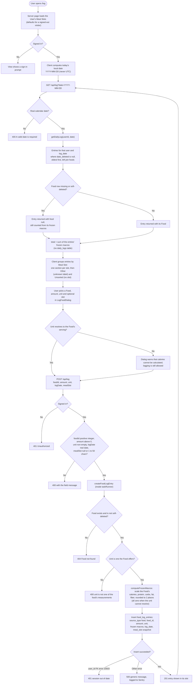

# Food log flow

How a User logs a Food they ate and how the Daily Log for a day is read back. Covers `food_log_entries`. Decision record: ADR-0025 (the log is a decoupled nutrition ledger with frozen macros and a client-derived local day). Terms (Food Log Entry, Daily Log, Log Date, Meal Slot) are in `CONTEXT.md`.

Last verified: 2026-11-25, against 524861d

Key code: `src/views/Log/Index.tsx`, `src/views/Log/LogFoodDialog.tsx`, `src/lib/api/foodLog.ts`, `app/api/log/route.ts`, `src/lib/foodLog.ts` (`createFoodLogEntry`, `computeFrozenMacros`, `getDailyLog`), `src/utils/foodNutrition.ts` (`macrosFor`, `unitResolvesForFood`), `src/utils/mealSlots.ts` (`groupEntriesBySlot`).

## Notes

- The macros are frozen when the entry is created and never recomputed on read, so editing a Food later does not change past totals (ADR-0025, Decision 2).
- The table has columns for `source_type` (`food`, `product`, `prepared_meal`) and `date_deleted`, but the code today only writes `source_type = food`, and there is no route to edit or delete an entry: `app/api/log/route.ts` has only `GET` and `POST`. ADR-0025's optional pantry link and stock deduction are not in the schema or the code yet. This diagram shows what runs today.
- `food_id` is `ON DELETE SET NULL` and the entry survives on its frozen macros; `user_id` cascades, so deleting an account removes its log.
- `meal_slot` is a text snapshot, not a foreign key: renaming or removing a slot in the profile never rewrites past entries, which then show under Other.
