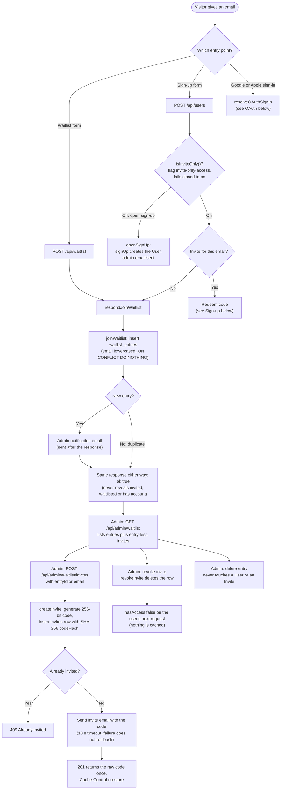
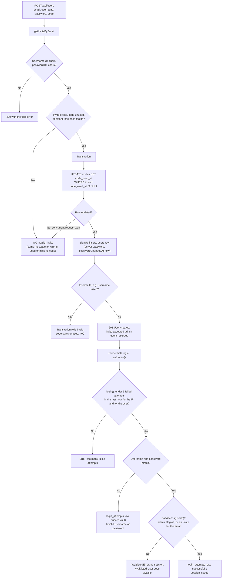
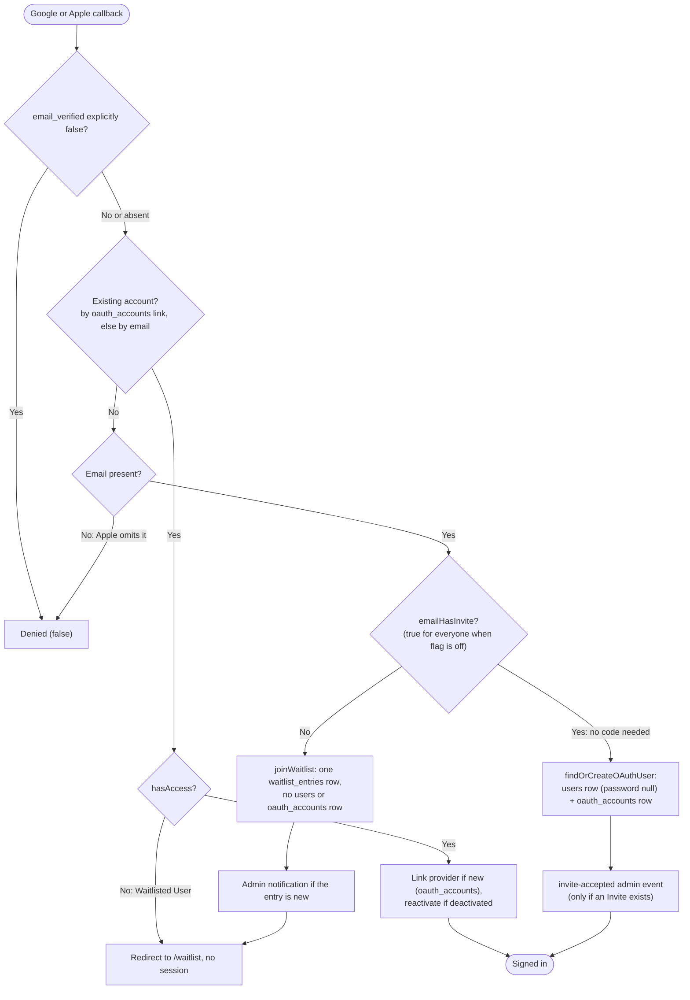

# Invite, waitlist and sign-up flow

How an email gets from the public Waitlist to an Invite, and how an Invite becomes a User through the sign-up form or OAuth. Covers `waitlist_entries`, `invites`, `oauth_accounts` and `login_attempts`. Decisions are in ADR-0032 (invite-only access, amended by #374 for the `invite-only-access` flag); domain terms (Waitlist Entry, Invite, Waitlisted User) are in `CONTEXT.md`.

Last verified: 2026-11-25, against 524861d

Key code: `src/lib/inviteOnly.ts` (`isInviteOnly`), `src/lib/access.ts` (`hasAccess`, `emailHasInvite`), `src/lib/waitlist.ts`, `src/lib/invites.ts`, `src/lib/waitlistResponse.ts`, `src/lib/oauthSignIn.ts`, `src/lib/oauth.ts`, `src/auth.ts`, `src/lib/users.ts` (`login`, `trackLoginAttempt`), `app/api/users/route.ts`, `app/api/waitlist/`, `app/api/admin/waitlist/`.

## Joining the waitlist and being invited

## Sign-up with an Invite, and the access check

## OAuth sign-in

## Notes

- A Waitlist Entry never creates a User, and a User never gets a status copied from an Invite. Access is derived from "this email has an Invite" on every request (`getSessionUser` and `proxy.ts` both call `hasAccess`).
- Invites never expire and the code is single-use; Google and Apple sign-in skip the code because the provider already verified the email.
- The sign-up route decides "no Invite" before it looks at the username or password, so an uninvited email always gets the waitlist response.
- A "leave the waitlist" link (`/waitlist/leave`, `app/api/waitlist/leave`) deletes the entry and deactivates a Waitlisted User with no Invite; it is not drawn here.
- `login_attempts` also records password-reset requests (rows with `successful` 1 and no user); see `password-reset.md`.
