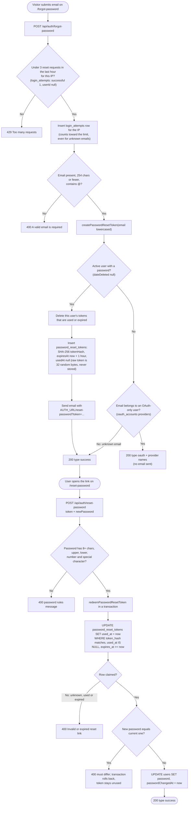
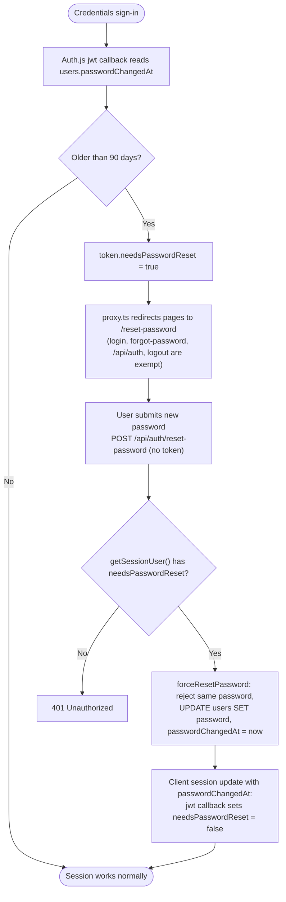

# Password reset flow

How a forgotten password is reset by email, and how the 90-day rotation forces a reset for a signed-in credentials User. Covers `password_reset_tokens` (and the `login_attempts` rate limit). Decision record: ADR-0006.

Last verified: 2026-11-25, against 524861d

Key code: `app/api/auth/forgot-password/route.ts`, `app/api/auth/reset-password/route.ts`, `src/lib/users.ts` (`checkPasswordResetRateLimit`, `createPasswordResetToken`, `redeemPasswordResetToken`, `forceResetPassword`, `getOAuthProvidersForEmail`), `src/auth.ts` (`isPasswordExpired`, `jwt` callback), `proxy.ts`.

## Reset by email link

## Forced reset after 90 days

## Notes

- ADR-0006 says tokens are marked used rather than deleted. That holds at redemption, but the next reset request for the same user deletes that user's used and expired tokens. Unused, unexpired tokens from earlier requests stay valid until they expire or are used.
- Only credentials sign-in sets `needsPasswordReset`; OAuth sign-in never does (OAuth-only Users have no password).
- OAuth-only Users get a provider message and no email, so that response differs from the unknown-email response; this is as ADR-0006 decided.
