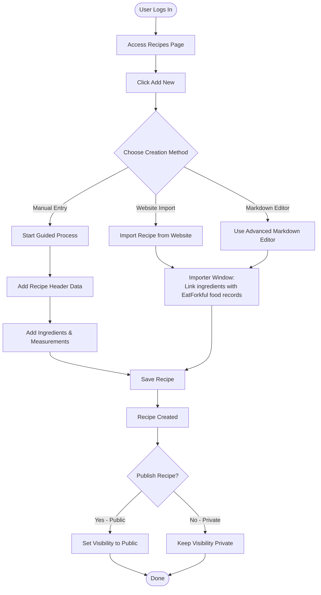

# Recipe builder flow

How a signed-in user creates a recipe: from the Recipes page through "Add New", the three creation methods (guided entry, website import, Markdown editor), the shared Importer window, saving, and visibility. Diagram by Steve; it is the intended flow, and the PR that added it lists where the code currently differs.

Last verified: 2026-11-16, against commit 6e50725

Key files: `src/views/Recipes/Index.tsx` (Add New), `src/views/Recipe/Store.tsx` (guided entry and mode switch), `src/views/Recipe/RecipeImporter.tsx` (website import), `src/views/Recipe/MarkdownImport.tsx` (Markdown editor), `src/views/Recipe/RecipeImportPreview.tsx` (Importer window), `src/views/Recipe/Index.tsx` (publish and visibility).

