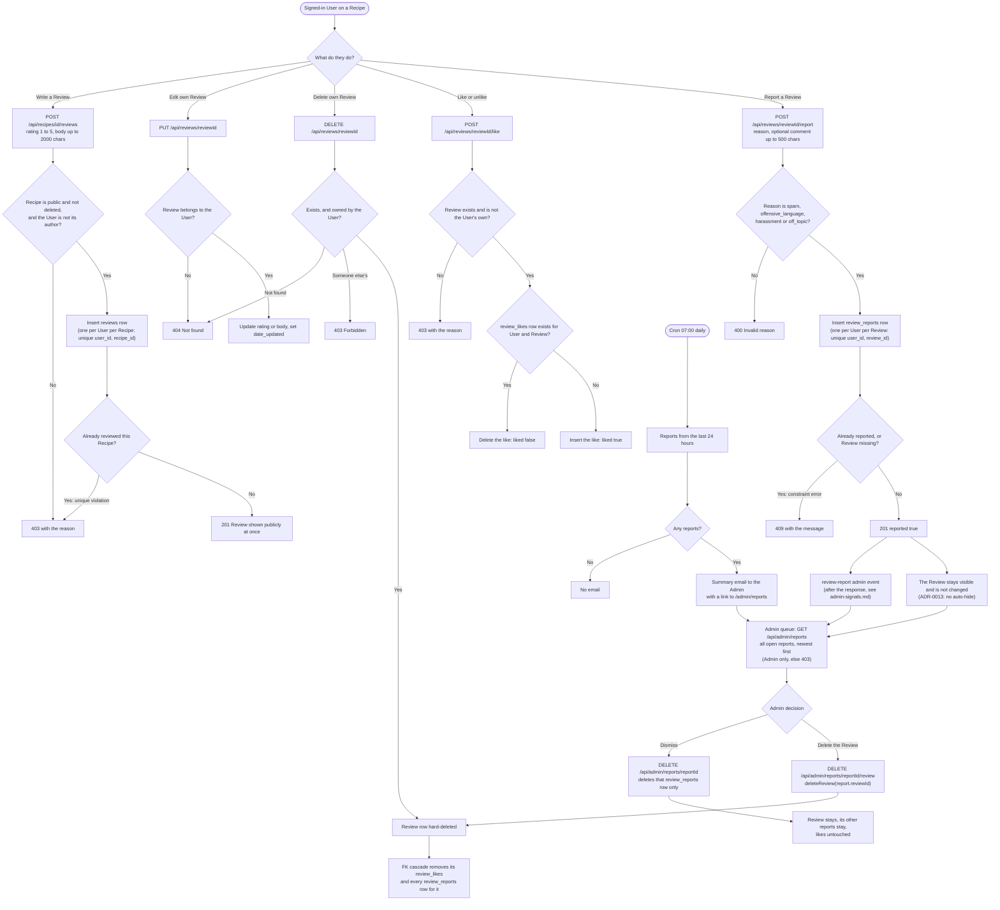

# Review moderation flow

How a Review is written, liked and reported, and how the Admin actions a Review Report. Covers `reviews`, `review_likes` and `review_reports`. Decision record: ADR-0013 (a reported Review stays visible until the Admin actions it). Terms (Review, Review Report, Admin) are in `CONTEXT.md`.

Last verified: 2026-11-25, against 524861d

Key code: `src/lib/reviews.ts`, `app/api/recipes/[id]/reviews/route.ts`, `app/api/reviews/[reviewId]/` (`route.ts`, `like/`, `report/`), `app/api/admin/reports/` (`route.ts`, `[reportId]/route.ts`, `[reportId]/review/route.ts`), `app/api/cron/review-reports/daily/route.ts`, `vercel.json` (cron `0 7 * * *`). The admin email on a new report is described in `admin-signals.md`.

## Notes

- Nothing here is a soft delete: reviews, likes and reports are removed with `DELETE`, so the tables have no `date_deleted`.
- A Recipe's author cannot delete a Review on their Recipe; they can only report it (`CONTEXT.md`, Review Report).
- `user_id` on all three tables is `ON DELETE SET NULL`, so a Review, like or report outlives its author's account (the author then shows as no username). Recipes are soft-deleted, but a hard delete of a Recipe row cascades to its Reviews, and from them to likes and reports.
- The report route does not check that the Review exists before inserting; a missing Review surfaces as the same 409 as a duplicate report.
