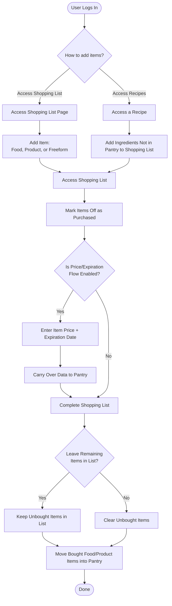

# Shopping list flow

How items get onto the shopping list, get checked off, and end up in the pantry when the trip is completed. The diagram is Steve's (issue #278); domain terms are defined in `CONTEXT.md` (Shopping List, Shopping List Item, Pantry-Gap Fill, Shopping Trip Completion).

Last verified: 2026-11-16, against 6e50725

Key code: `src/views/ShoppingList/Index.tsx`, `src/views/Recipe/Index.tsx` (Add Missing to List), `src/lib/shoppingList.ts` (`fillPantryGapFromRecipe`, `completeShoppingTrip`), `app/api/shopping-list/`.

